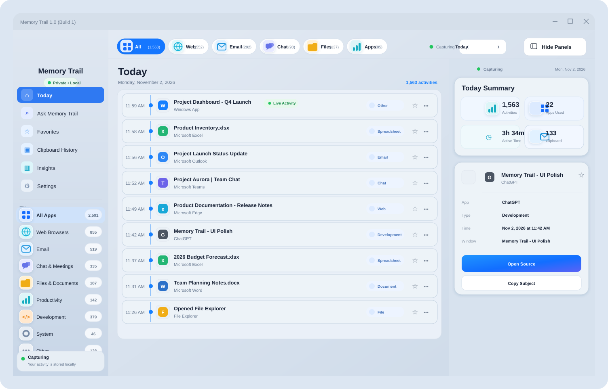
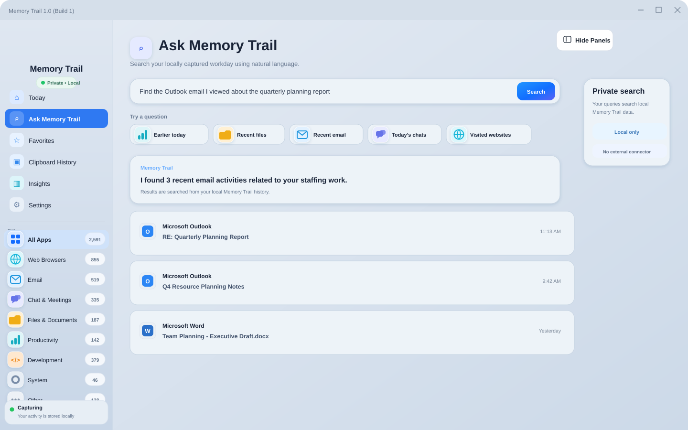
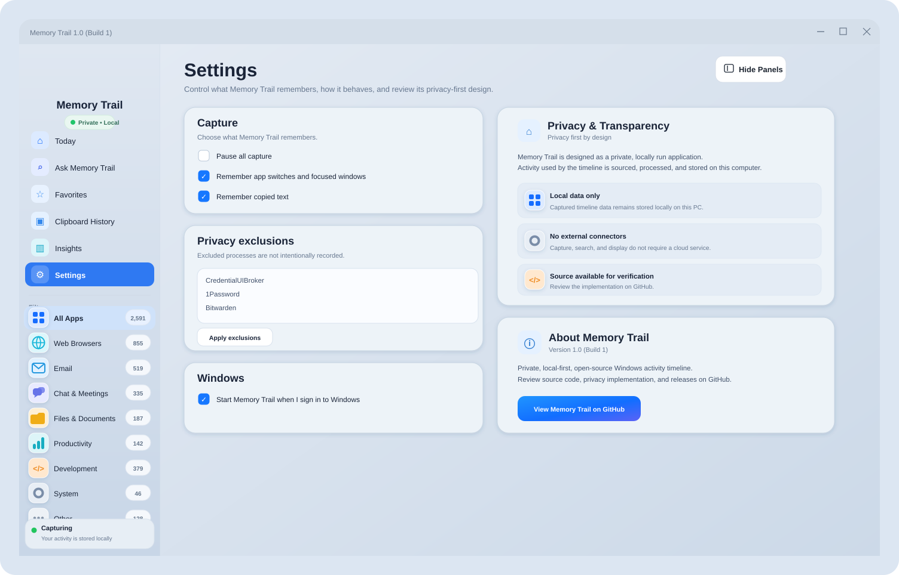
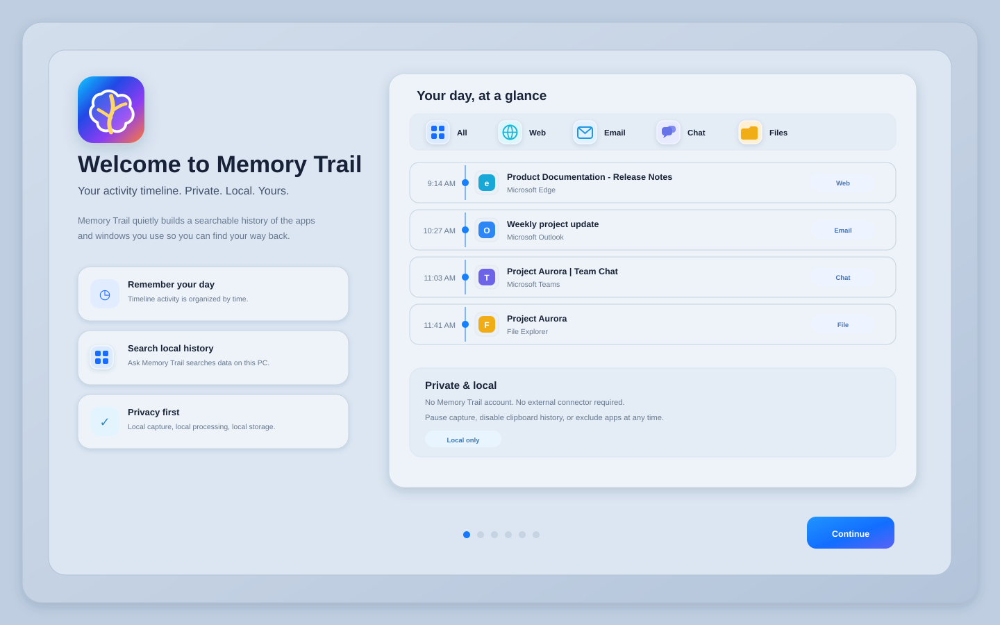

# Memory Trail for Windows

**Memory Trail 1.0 (Build 1)** is a privacy-first Windows activity timeline that helps you retrace what you were working on while keeping captured history on the Windows PC where it was created.

> **Local capture · Local processing · Local storage · Local search · No Memory Trail account · No captured-history cloud sync · Open source**

[Download the latest release](https://github.com/ram1424/Memory-Lane-Windows/releases/latest) · [Read the privacy & data-handling policy](PRIVACY.md) · [macOS edition](https://github.com/ram1424/Memory-Lane)

## Privacy at a glance

Memory Trail is intentionally built so its core timeline workflow stays on your computer.

| Stage | What Memory Trail does |
| --- | --- |
| **Capture** | Reads foreground-app/window context and, when enabled, copied text from Windows APIs on this PC. |
| **Process** | Normalizes titles, categorizes activity, removes duplicate events, calculates local summaries, and prepares search results inside the app. |
| **Store** | Saves timeline history and preferences as local JSON files under your Windows user profile. |
| **Search** | **Ask Memory Trail** searches the locally stored timeline; it does not require a cloud AI service or external connector. |
| **Control** | Pause capture, disable app activity or clipboard capture, exclude processes, clear history, and reset preferences from Settings. |
| **Network** | Memory Trail does not upload or synchronize captured timeline history and does not include analytics or advertising SDKs. |

### Local data locations

Timeline history:

```text
%LOCALAPPDATA%\Memory Trail\timeline.json
```

Preferences, capture settings, and exclusions:

```text
%LOCALAPPDATA%\Memory Trail\preferences.json
```

Local crash/non-fatal diagnostics, when generated:

```text
%LOCALAPPDATA%\Memory Trail\crash.log
```

**Important clipboard note:** clipboard capture is enabled by default. When enabled, copied text can be stored in the local timeline. You can turn clipboard capture off at any time in **Settings → Capture**. Memory Trail currently ignores clipboard text longer than 20,000 characters.

Memory Trail does not add a separate application-level encryption layer to these JSON/log files. They are stored inside the signed-in user's Windows profile and rely on Windows account/file-system protections and any device encryption you have enabled.

## Screenshots

The screenshots below use representative demo data. They are **SVG** images so text remains crisp when zoomed.

**Click any screenshot to open the full-resolution version.**

### Today timeline

<a href="docs/screenshots/timeline.svg">
  
</a>

### Ask Memory Trail

<a href="docs/screenshots/ask-memory-trail.svg">
  
</a>

### Settings — Privacy & Data

<a href="docs/screenshots/privacy-settings.svg">
  
</a>

### First-run tutorial

<a href="docs/screenshots/onboarding.svg">
  
</a>

## What Memory Trail does

The current Windows release includes:

- **Today timeline** with newest activity first and a green **Live Activity** indicator tied to the latest captured activity.
- **Foreground-app capture** using Windows foreground events, a polling fallback, and automatic collector recovery.
- **Window context capture** for meaningful titles Windows exposes, including browser pages/tabs, Outlook subjects, Teams/conversation titles, File Explorer folders, Office documents, PDFs, and other desktop windows.
- **Application fallback logging** so an app switch can still be recorded when Windows does not expose a useful title.
- **Clipboard History** for copied text when clipboard capture is enabled.
- **Ask Memory Trail** for local searches across apps, websites, email, conversations, files, time ranges, and nearby activity.
- **Favorites**, manual memories, category filters, **Today Summary**, **Insights**, and a detailed activity side panel.
- **Session-based active time** using inactivity boundaries instead of counting every event as a separate minute.
- **Show/Hide Panels** for a cleaner workspace.
- **Windows system tray** operation and optional **Start with Windows**.
- A privacy-first onboarding tutorial and polished startup/loading experience.
- Self-contained Windows x64 packaging with no separate .NET installation required.

## What may be captured

Depending on the active application and what Windows exposes, a timeline item may include:

- process and friendly application name;
- executable path used to reopen an application;
- foreground window title;
- browser page/tab title;
- Outlook email subject;
- Teams or other conversation title;
- File Explorer folder/file context;
- Word, Excel, PowerPoint, OneNote, Notepad, PDF, or other document title;
- copied text when **Clipboard** capture is enabled;
- a copied HTTP/HTTPS URL when clipboard text is recognized as a URL;
- timestamp, category, favorite state, and locally generated activity metadata.

If a useful title is unavailable, Memory Trail can record an app-level event such as **Opened Microsoft Edge** rather than dropping the activity.

## What Memory Trail does not intentionally capture

Memory Trail is not designed to:

- record your screen or take screenshots;
- record audio or video;
- capture typed keystrokes;
- act as a keylogger;
- upload captured timeline history to a Memory Trail cloud service;
- synchronize captured timeline history between computers;
- send captured history to analytics or advertising providers;
- require a Memory Trail account;
- require an external connector for capture, storage, timeline display, Insights, or Ask Memory Trail.

Opening GitHub from the app is a user-initiated action that launches your default browser and is separate from the local capture/storage workflow.

## Privacy controls in Settings

**Settings → Privacy & Data** explains how information moves through the app:

1. **Captured locally** from Windows foreground/UI Automation and clipboard APIs.
2. **Processed locally** inside Memory Trail.
3. **Stored locally** under `%LOCALAPPDATA%\Memory Trail`.
4. **Searched locally** by Ask Memory Trail.
5. **Not automatically uploaded, synchronized, or sent to analytics/advertising services** by Memory Trail.

You can also:

- pause all capture;
- turn **App Activity** capture on or off;
- turn **Clipboard** capture on or off;
- exclude Windows processes from both app-activity and clipboard writes;
- clear the local timeline;
- reset preferences without deleting timeline history;
- enable or disable **Start with Windows**;
- review the source code in this repository.

Default excluded processes:

- `CredentialUIBroker`
- `1Password`
- `Bitwarden`

See [PRIVACY.md](PRIVACY.md) for the complete privacy and data-handling description.

## Capture reliability

Build 1 includes:

- Windows foreground-change event hook;
- one-second polling fallback;
- immediate capture when the collector starts;
- Windows UI Automation title fallback;
- automatic capture-service health checks and restart;
- accurate UI status for **Capturing**, **Capture paused**, **App capture off**, and **Starting capture**.

## Download

The Releases page is intentionally kept clean: **only the current release should remain published**.

Download **Memory Trail 1.0 (Build 1)** from the [latest release](https://github.com/ram1424/Memory-Lane-Windows/releases/latest), extract the ZIP, and run:

```text
Memory Trail.exe
```

## Build from source

Requirements:

- Windows 10 or Windows 11
- .NET 8 SDK

```powershell
dotnet restore .\MemoryTrail.Windows.csproj
dotnet build .\MemoryTrail.Windows.csproj -c Release
dotnet run --project .\MemoryTrail.Windows.csproj
```

Create a self-contained x64 build:

```powershell
dotnet publish .\MemoryTrail.Windows.csproj `
  -c Release `
  -r win-x64 `
  --self-contained true `
  -p:PublishSingleFile=true `
  -p:IncludeNativeLibrariesForSelfExtract=true `
  -p:EnableCompressionInSingleFile=true `
  -o .\publish
```

## Technology

Memory Trail for Windows is built with:

- .NET 8
- WPF
- Win32 foreground-window APIs
- Windows UI Automation
- Windows clipboard APIs
- local JSON persistence
- GitHub Actions for self-contained Windows release builds

## Version

**Memory Trail 1.0 (Build 1)**

The in-app **Settings → About Memory Trail** section links back to this repository for source review, privacy verification, release information, and project history.
