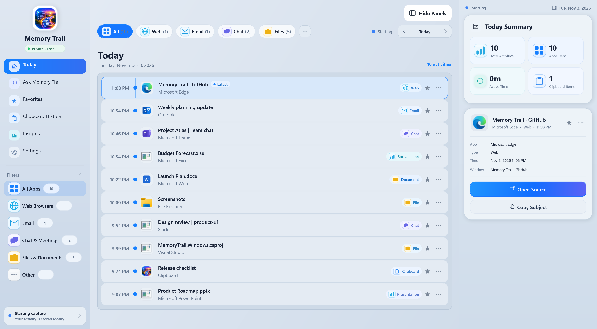
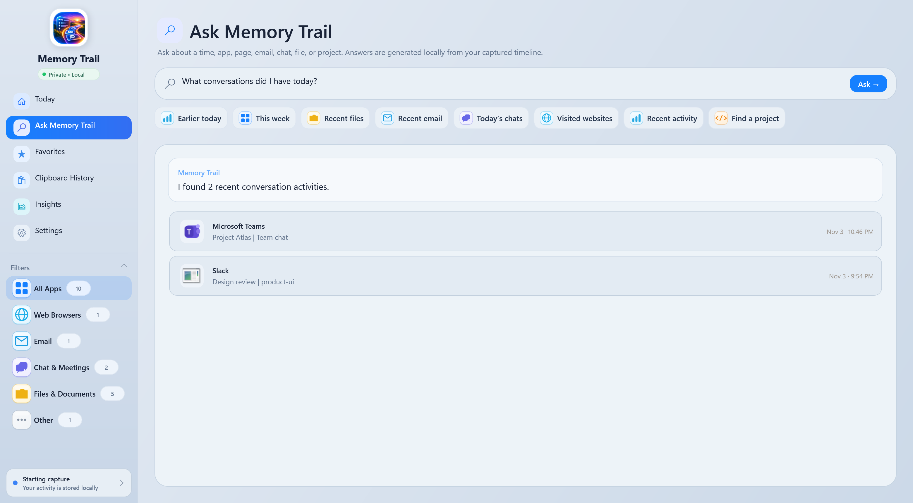
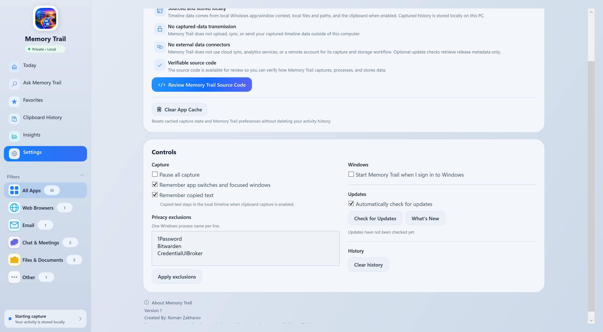
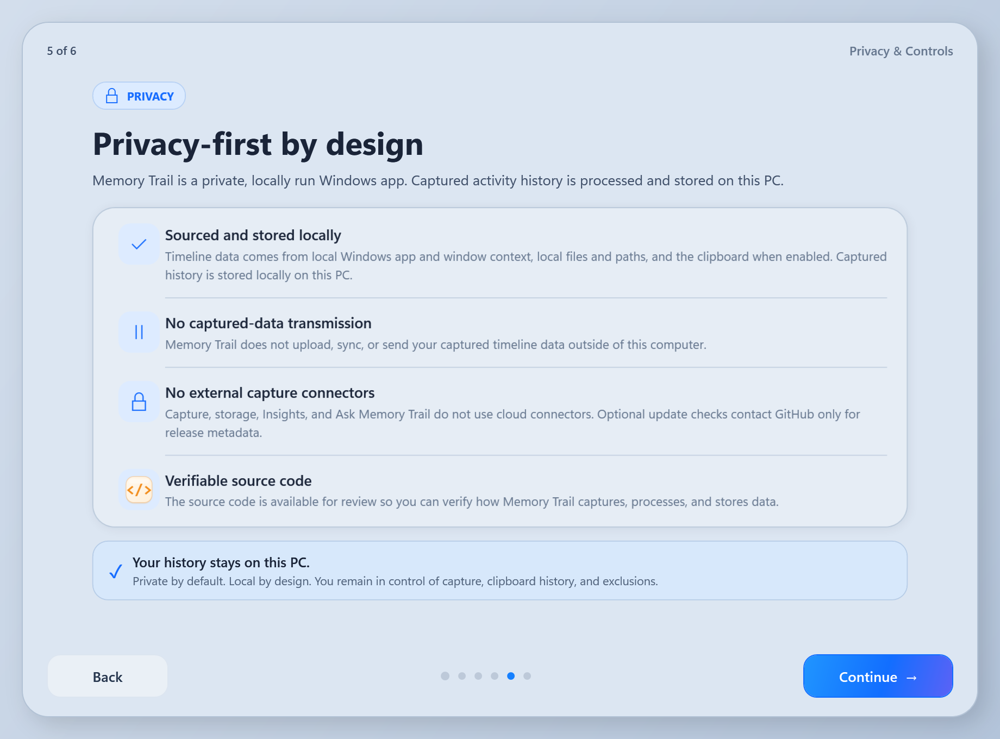

# Memory Trail for Windows

<p align="center">
  
</p>

<p align="center"><strong>Your workday, remembered locally.</strong></p>

Memory Trail is a privacy-first Windows activity timeline for retracing what you were doing across browsers, email, chat, files, documents, apps, and the clipboard. It turns useful local Windows app/window context into a searchable chronological history without requiring a cloud account or external data connector.

**Release line: Memory Trail 1.2** — current production build is **Version 1.2 Build 6**.

## Download

[Download the latest Memory Trail release](https://github.com/ram1424/Memory-Trail-Windows/releases/latest)

Requires **Windows 10 or Windows 11 (x64)**. The release is self-contained and does not require a separate .NET installation.

## What Memory Trail Does

- **Live activity timeline** with the newest activity first
- **Live Activity** state tied to the most recently captured event
- **Ask Memory Trail** search across locally stored history
- **Browser context** including page/tab titles when Windows exposes them
- **Outlook context** including subject-level activity when available
- **Teams and chat context** including supported conversation/window titles
- **Files and documents** from File Explorer and supported productivity apps
- **Clipboard History** for copied text and links when enabled
- **Favorites** for important timeline entries
- **Manual memories** for notes and references you want to save yourself
- **Today Summary and Insights** based on local timeline activity
- **App/process exclusions** so selected software is not recorded
- **Pause capture** and independent App Activity / Clipboard controls
- **System tray operation** and optional **Start with Windows**
- **Built-in update checks** on each launch with **Update / Remind Me in 24 Hours / Skip This Version**
- **Background update staging** downloads and verifies the release while Memory Trail stays usable, then installs it silently after the app exits
- **What's New** changelog shown after upgrading
- **Local JSON storage** under the signed-in Windows user profile
- **Privacy-focused onboarding and Settings controls**
- **No AI-generated timeline summaries**
- **No Memory Trail account required**

## Screenshots

### Today


### Ask Memory Trail


### Settings & Privacy


### First-run Tutorial


_All screenshots use generic demo data._

## Privacy

Memory Trail is designed around a simple principle: **your captured activity history stays on your Windows PC.**

### Local capture and storage

- Activity is sourced from local Windows foreground-window APIs and Windows UI Automation.
- Captured history is processed locally inside Memory Trail.
- Timeline history is stored locally at:
  `%LOCALAPPDATA%\Memory Trail\timeline.json`
- Preferences, exclusions, and capture settings are stored locally at:
  `%LOCALAPPDATA%\Memory Trail\preferences.json`
- Crash/non-fatal diagnostic logs, when created, stay under:
  `%LOCALAPPDATA%\Memory Trail`
- Clipboard history is local and can be disabled at any time.
- **Ask Memory Trail searches the local timeline and does not require a cloud AI service.**

Memory Trail currently relies on Windows account/file-system protections and any device encryption enabled on the PC; it does not add a separate application-level encryption layer to its JSON/log files.

### No external data pipeline

- **No cloud timeline sync**
- **No external data connectors required**
- **No Memory Trail account**
- **No remote account required for capture**
- **No analytics SDK**
- **No advertising SDK**
- **No transmission of captured timeline history to an external service**
- **No AI-generated summaries of your timeline**

Opening the GitHub project from Settings is a user-initiated browser action and is separate from the local capture/storage workflow.

When automatic update checks are enabled, Memory Trail makes a separate request to GitHub for release metadata on each app launch. The request does **not** include captured timeline history, clipboard content, window titles, or file paths. Automatic update checks can be disabled in Settings.

The current source repository is private, so anonymous GitHub release checks cannot read its releases. Authorized private-repository checks can use the `MEMORY_TRAIL_GITHUB_TOKEN` environment variable; otherwise the updater fails safely and offers the Releases page.

### User controls

- Pause all capture at any time.
- Enable or disable App Activity capture.
- Enable or disable Clipboard capture.
- Exclude installed processes from capture.
- `CredentialUIBroker`, `1Password`, and `Bitwarden` are excluded by default.
- Clear local timeline history from Settings.
- Clear App Cache resets cached capture state and preferences without deleting activity history.
- Review the source code in this repository to verify capture, storage, and privacy behavior.

Clipboard capture is enabled by default in the current Windows build. When enabled, copied text may be stored locally in the timeline. Clipboard text longer than 20,000 characters is ignored by the current collector.

Memory Trail is intended as a personal productivity and activity-retracing tool. It is **not** designed as employee monitoring software, a keylogger, or a screen recorder.

See [Privacy & Data Handling](docs/PRIVACY.md) for the full privacy and data-handling description.

## Data Sources

Depending on the app and what Windows exposes, Memory Trail can retain useful context such as:

- Active application and process names
- Focused window titles
- Browser page/tab titles
- Email subject lines
- Supported chat/conversation titles
- Folder, file, and document names
- Executable paths used for reopening supported activity
- Copied text and links when Clipboard capture is enabled
- Timestamps, categories, favorites, and locally generated activity metadata

If Windows does not expose a useful window title, Memory Trail can save an app-level event such as **Opened Microsoft Edge** rather than dropping the activity.

Memory Trail records metadata/context exposed by Windows and supported applications; it is not a screen recorder.

## Repository Layout

```text
Assets/              App icons and branding
Controls/            Reusable UI controls
Core/                Shared application-level source
Models/              Timeline/data models
Services/            Capture, storage, preferences, updates
Tools/               Build and screenshot tooling
Views/               Windows and their code-behind
Reference/macOS/     macOS UI reference used for parity
docs/                Privacy, changelog, release notes, screenshots
```

The repository root intentionally contains only the application entry point, project file, README, and top-level project folders.

## Build From Source

1. Clone this repository.
2. Install the **.NET 8 SDK** on Windows.
3. Restore and build the project:

```powershell
dotnet restore .\MemoryTrail.Windows.csproj
dotnet build .\MemoryTrail.Windows.csproj -c Release
dotnet run --project .\MemoryTrail.Windows.csproj
```

Create a self-contained x64 build:

```powershell
dotnet publish .\MemoryTrail.Windows.csproj `
  -c Release `
  -r win-x64 `
  --self-contained true `
  -p:PublishSingleFile=true `
  -p:IncludeNativeLibrariesForSelfExtract=true `
  -p:EnableCompressionInSingleFile=true `
  -o .\publish
```

**Source baseline:** `1.2 Build 6`

## Release

Only the current production release is retained on the GitHub Releases page.

**Memory Trail 1.0.1** begins the production semantic patch release line. Every push to `main` advances the patch version automatically.

[macOS edition](https://github.com/ram1424/Memory-Trail)


## Microsoft Store / MSIX

Memory Trail includes a dedicated Microsoft Store MSIX packaging pipeline. Store builds disable the GitHub self-updater and rely on Microsoft Store for updates. See [docs/MICROSOFT_STORE.md](docs/MICROSOFT_STORE.md).
